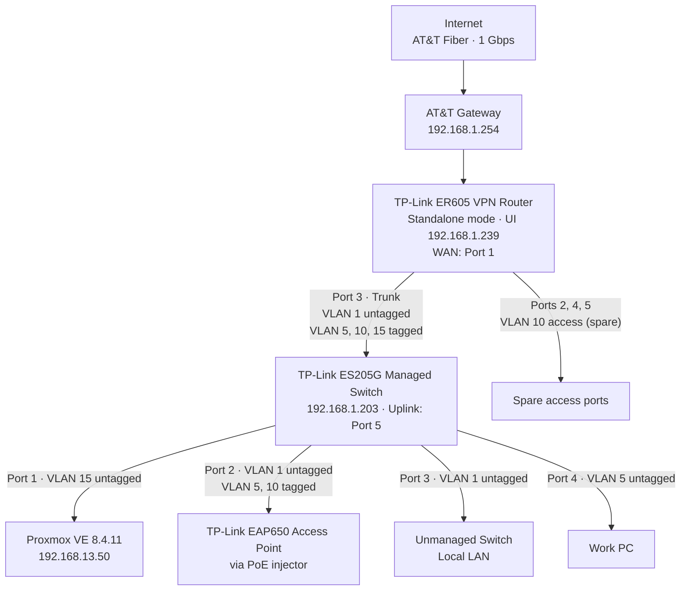
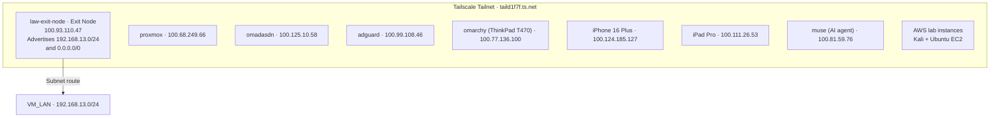

# Home Lab Setup

A documented overview of my home lab environment, networking layout, and self-hosted services. This repository is used to track infrastructure, experiments, and future improvements — and as a working record of the networking, virtualization, and security skills I use every day.

## Overview

My lab includes:

- A segmented home network with VLANs, firewall rules, and centralized DNS filtering.
- A Proxmox virtualization host running containers and VMs for core services.
- A Tailscale tailnet (VPN mesh) tying together home, mobile, and cloud machines.
- Cloud test instances for cybersecurity and service validation.
- A few additional services I plan to deploy and test.

## Network Diagram

### Physical topology

### VLAN segmentation

```mermaid
flowchart TB
    ER605["TP-Link ER605<br/>Routes and firewalls<br/>all four VLANs"]
    ER605 --> H1["Home devices"]
    ER605 --> W1["Work PC"]
    ER605 --> I1["IoT &amp; wireless devices"]
    ER605 --> V1["Proxmox host · 192.168.13.50"]

    subgraph Home["VLAN 1 — Home_LAN · 192.168.11.0/24"]
        H1["Home devices"]
        H2["Canon PIXMA TR4720<br/>192.168.11.110"]
        H3["Wi-Fi: The_Promise_LAN"]
    end
    subgraph Work["VLAN 5 — Work_LAN · 172.16.11.0/24"]
        W1["Work PC"]
        W2["Wi-Fi: The_Promise_Work"]
    end
    subgraph IoT["VLAN 10 — WIFI_IOT · 192.168.12.0/24"]
        I1["IoT &amp; wireless devices"]
        I2["Wi-Fi: The_Promise_IOT"]
        I3["Wi-Fi: The_Promise_Guest"]
    end
    subgraph VM["VLAN 15 — VM_LAN · 192.168.13.0/24"]
        V1["Proxmox host · 192.168.13.50"]
        V2["AdGuard Home · 192.168.13.103"]
        V3["Portainer · 192.168.13.51:9443"]
        V4["Omada SDN Controller · LXC CT 104"]
        V5["RustDesk · Stirling PDF · pfSense (lab)"]
    end
```

### Tailscale VPN overlay

## Network Segmentation (VLANs)

| VLAN | Name | Subnet | Gateway | DHCP | Purpose |
| --- | --- | --- | --- | --- | --- |
| 1 | Home_LAN | 192.168.11.0/24 | 192.168.11.1 | Enabled (.100–.199) | General home devices, printer, main Wi-Fi |
| 5 | Work_LAN | 172.16.11.0/24 | 172.16.11.1 | Enabled | Work PC and work Wi-Fi, fully isolated from Home |
| 10 | WIFI_IOT | 192.168.12.0/24 | 192.168.12.1 | Enabled | IoT and guest wireless devices |
| 15 | VM_LAN | 192.168.13.0/24 | 192.168.13.1 | Enabled | Proxmox host, containers, and lab services |

## Network Hardware

| Device | Role | Address | Connection |
| --- | --- | --- | --- |
| AT&T Gateway | ISP modem/router, internet uplink | 192.168.1.254 | WAN side of the ER605 |
| TP-Link ER605 | VPN router, DHCP, firewall/ACLs | 192.168.1.239 (UI) | Standalone mode (not Omada-managed) |
| TP-Link ES205G | 5-port managed switch, 802.1Q VLANs | 192.168.1.203 | Uplink to ER605 port 3 |
| TP-Link EAP650 | Wireless access point | via switch port 2 | PoE injector (switch has no PoE) |
| Canon PIXMA TR4720 | Home printer (Wi-Fi, AirPrint) | 192.168.11.110 | Home_LAN (VLAN 1) |
| Proxmox host | Virtualization server (laptop hardware) | 192.168.13.50 | Switch port 1, VLAN 15 |
| Work PC | Work workstation | VLAN 5 | Switch port 4 |
| Unmanaged switch | Local LAN expansion | VLAN 1 | Switch port 3 |

## Router & Switch Port Maps

### ER605 (router)

| Port | Mode | VLANs |
| --- | --- | --- |
| 1 | WAN | 4094 untagged |
| 2 | LAN access | 10 untagged (spare) |
| 3 | Trunk to ES205G | 1 untagged, 5/10/15 tagged |
| 4 | LAN access | 10 untagged (spare) |
| 5 | LAN access | 10 untagged (spare) |

### ES205G (switch)

| Port | Connects to | VLANs | PVID |
| --- | --- | --- | --- |
| 1 | Proxmox host / VMs | 15 untagged | 15 |
| 2 | PoE injector → EAP650 AP | 1 untagged, 5/10 tagged | 1 |
| 3 | Unmanaged switch (Local LAN) | 1 untagged | 1 |
| 4 | Work PC | 5 untagged | 5 |
| 5 | Router uplink (ER605 port 3) | 1 untagged, 5/10/15 tagged | 1 |

## Wi-Fi (EAP650)

| SSID | VLAN | Notes |
| --- | --- | --- |
| The_Promise_LAN | 1 (Home_LAN) | Main network, WPA2-PSK |
| The_Promise_Work | 5 (Work_LAN) | Work network |
| The_Promise_IOT | 10 (WIFI_IOT) | IoT devices |
| The_Promise_Guest | 10 (WIFI_IOT) | Guest network |

## DNS — AdGuard Home

AdGuard Home is the DNS server for the whole network: **192.168.13.103** (web UI on port 3000; port 80 on that box is an Apache default page, not AdGuard). The ER605 hands out 192.168.13.103 as the DNS server on Home, Work, and IoT DHCP. Upstream DNS: 1.1.1.1, 1.0.0.1, 9.9.9.9.

- Proxmox host DNS: 1.1.1.1 / 8.8.8.8.
- DNS rewrite for the reverse proxy: `portainer.home.lan` → 192.168.13.51.

## Access Control — ER605 Firewall Rules

Rules are evaluated **top-down, first match wins**. All are LAN→LAN, any time. The two Allow DNS rules sit **above** the matching Deny rules — the ER605 UI has no reorder button, so that ordering was built by deleting the Deny rules, adding the Allows, and re-adding the Denies.

| # | Name | Policy | Service | Source | Destination |
| --- | --- | --- | --- | --- | --- |
| 1 | HOME_VMLAN | Allow | ALL | Home_LAN | VM_LAN |
| 2 | Allow_Print | Allow | ALL | Home_LAN | WIFI_IOT |
| 3 | Deny_Work | Block | ALL | Work_LAN | Home_LAN |
| 4 | Deny_Work_IOT | Block | ALL | Work_LAN | WIFI_IOT |
| 5 | Deny_HM_Work | Block | ALL | Home_LAN | Work_LAN |
| 6 | Deny_IOT_HM | Block | ALL | WIFI_IOT | Home_LAN |
| 7 | Deny_IOT_Work | Block | ALL | WIFI_IOT | Work_LAN |
| 8 | Deny_VM_WK | Block | ALL | VM_LAN | Work_LAN |
| 9 | Deny_VM_HM | Block | ALL | VM_LAN | Home_LAN |
| 10 | Deny_VM_IOT | Block | ALL | VM_LAN | WIFI_IOT |
| 11 | Allow_IOT_VM | Allow | DNS (53) | WIFI_IOT | VM_LAN |
| 12 | Allow_Work_VM | Allow | DNS (53) | Work_LAN | VM_LAN |
| 13 | Deny_Work_VM | Block | ALL | Work_LAN | VM_LAN |
| 14 | Deny_IOT_VM | Block | ALL | WIFI_IOT | VM_LAN |

What the structure does:

- **Work_LAN is fully isolated from Home_LAN, both directions** (rules 3 and 5). The work PC reaches only the internet (plus DNS to AdGuard via rule 12).
- **Home_LAN can reach VM_LAN and WIFI_IOT freely** (rules 1 and 2) — this is how home devices reach AdGuard, Portainer, and the printer.
- **IoT and VM networks cannot initiate connections into Home, Work, or each other** (rules 6–10, 13, 14). Replies to connections started from Home_LAN still return (stateful), so Home→VM and Home→IoT access keeps working.
- **DNS exceptions (rules 11 and 12):** IoT and Work devices use AdGuard (192.168.13.103) as their DNS. DNS (port 53) from WIFI_IOT and Work_LAN to VM_LAN is allowed so name resolution works; everything else from those networks to VM_LAN stays blocked. If a DNS Allow ever ends up below its matching Deny rule, DNS breaks on that network ("Connected, no internet" with a valid IP) — that exact fault is how this ordering was found.

## Virtualization Host

My main virtualization platform is Proxmox VE 8.4.11, running on laptop hardware (node `proxmox`, 192.168.13.50, VM_LAN). Proxmox host DNS is 1.1.1.1 / 8.8.8.8.

## Containers and Services

### LXC Containers

- pfSense - Firewall service (lab firewall, not the network gateway).
- Portainer for Docker management (https://192.168.13.51:9443/).
- Stirling PDF for document editing.
- Nginx Proxy Manager for reverse proxy handling.
- --+ cloudflare account
- RustDesk server components for remote access.
- Tailscale container for connectivity.
- Nextcloud for self-hosted file management.
- AdGuard for local DNS filtering (192.168.13.103, UI port 3000).
- Tailscale exit node.
- Omada SDN Controller (CT 104) for central management of the EAP650 and ES205G.

### Virtual Machines

- Kasm Workspaces for spinning up disposable Linux workspaces.
- Kali Purple for defensive cybersecurity testing.

## Tailscale Tailnet (VPN)

Tailnet: `taild1f7f.ts.net`. Every device below is reachable by name or 100.x address from anywhere, without opening ports on the router. The exit node `law-exit-node` advertises the VM_LAN subnet route (192.168.13.0/24) and full-tunnel exit (0.0.0.0/0).

| Device | Role | Tailscale IP |
| --- | --- | --- |
| law-exit-node | Exit node, subnet router | 100.93.110.47 |
| proxmox | Proxmox host | 100.68.249.66 |
| omadasdn | Omada SDN Controller (CT 104) | 100.125.10.58 |
| adguard | AdGuard Home | 100.99.108.46 |
| portainer-ts | Portainer | 100.88.117.42 |
| kali-prox | Kali VM on Proxmox | 100.79.168.4 |
| omarchy | ThinkPad T470 laptop (Omarchy Linux) | 100.77.136.100 |
| gestez-t470 | ThinkPad T470 (second machine) | 100.106.23.94 |
| ilaw-16plus | iPhone 16 Plus | 100.124.185.127 |
| ipad-pro-11-gen-3 | iPad Pro | 100.111.26.53 |
| kasm-host | Kasm Workspaces host | 100.85.244.56 |
| muse | AI agent device | 100.81.59.76 |
| gesetz-v3 / gesetz-15-bw0xx | Lab devices (roles TBD) | 100.67.209.49 / 100.102.137.116 |

Tailscale SSH is enabled on the tailnet, with access controlled by the tailnet ACL (allow-all traffic ACL; SSH rules gate which users can reach which nodes).

## Cloud Test Instances

I also use AWS cloud instances for remote testing and validation.

- Kali EC2 instance for cybersecurity tooling.
- Ubuntu EC2 instance for service testing and experimentation.

## Services I Plan to Add

- Ansible for configuration management and automation.
- Uptime Kuma for monitoring.
- Jellyfin for media management, if I add NAS storage.
- An AI service or engine for future experimentation.

## My Goals

- Improve segmentation and security.
- Document infrastructure clearly.
- Test self-hosted tools in isolated environments.
- Expand automation and monitoring over time.
- have fun while i learn various technologies

## In Progress / Known Issues

- **Omada adoption:** the SDN Controller (CT 104) is installed and running, but the EAP650 and ES205G are not adopted yet. The networks, SSIDs, and switch port profiles must be built in the controller first — adopting wipes a device's current config — then adopt the AP first and the switch second.
- **Main Wi-Fi DHCP fault:** devices on The_Promise_LAN (VLAN 1) sometimes get no DHCP lease (APIPA 169.254.x). VLAN 10 DHCP is confirmed working, so the fault is specific to the VLAN 1 DHCP path — under investigation.

## Guides

- [Installing the Omada SDN Controller in a Proxmox LXC Container (Ubuntu 20.04)](omada-sdn-install-guide-ubuntu-20-04.md) — full walkthrough, including every error hit along the way and the corrections to the video guide it was based on.

## Notes

Private (RFC1918) and Tailscale (CGNAT 100.x) addresses are shown intentionally — none of them are reachable from the public internet. No credentials, passwords, Wi-Fi keys, or public access endpoints are published in this repository.

---

## Disclaimer

This project is for educational and personal lab use only. Any exposed services are intended for testing and controlled access.
